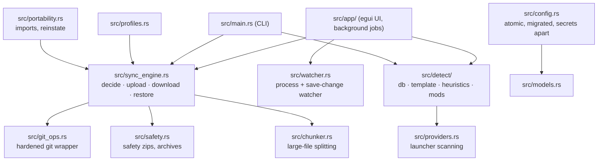

# SaveVault (`save_game_manager`)

SaveVault finds your installed games and where they keep their saves, keeps a history of
every change, lets you go back to any earlier point, keeps separate **profiles** (characters,
playthroughs, modded runs) for games that have no such feature, remembers the **mod setup**
each snapshot was made with, and syncs everything between PCs through a private git
repository (GitHub or any remote you own).

It is a single Rust binary with an `eframe`/`egui` desktop UI and a full command line.
See [REQUIREMENTS.md](./REQUIREMENTS.md) for the requirement history and test traceability.

---

## What it does

### Finds saves by itself

Detection combines four sources and reports a confidence and a plain-language reason for
every game:

| Source | How | Confidence |
|---|---|---|
| **Save location database** | The community [Ludusavi manifest](https://github.com/mtkennerly/ludusavi-manifest) (PCGamingWiki data, MIT) with ~22,600 games that list save paths. Downloaded once (≈18 MB), stored as a 1.7 MB index, refreshed weekly with a conditional request. Matched by Steam / GOG / Lutris id, then title, then install folder name. | 97 % (70 % when the location is known but no saves exist yet) |
| **Steam Cloud folder** | `userdata/<user>/<appid>/remote` | 85 % |
| **Smart scan** | Ranks folders in the game's Proton / Wine prefix and install folder by name similarity, save-like files and recency; ignores launcher, cache and crash folders. | up to 75 % |
| **Learn while playing** | When a game with no known location closes, SaveVault looks at which files changed during the session and adopts that folder. | 85 % |

Windows paths are resolved inside Proton / Wine prefixes case-insensitively, so the same
entry works on Linux, macOS and Windows. Locations are stored as portable templates
(`<winAppData>/EldenRing`, `<root>/userdata/<storeUserId>/555/remote`, …) so another machine
or a reinstall resolves the right folder on its own.

Launchers scanned: **Steam** (all library folders, Proton prefixes, non-Steam shortcuts),
**Heroic** (GOG, Epic, Amazon, sideloaded apps, with their Wine prefixes), **Legendary**,
**GOG**, **Epic Games Launcher**, **Lutris**, **Bottles**. Anything else can be added by hand.

Only confident results are protected automatically; guesses are listed as "Check location"
with one click to confirm or pick another folder. Games you removed are remembered and not
offered again.

### Snapshots, timeline, restore

- Every backup is a snapshot in a local git repository; only changes are stored.
- Snapshots happen when you click, when SaveVault starts, on a schedule, and **when a game
  closes** (a background watcher recognises game processes, including Steam / Proton / Wine).
  Games that are running are left alone until they exit.
- The **Timeline** shows every snapshot with time, PC, label and what changed. Restoring shows a
  preview first (files replaced / brought back / removed, and mod differences).
- **Nothing overwrites live saves without a safety zip.** Restores, profile switches and incoming
  cloud saves first zip the current files into `safety_backups/`, and "Put back" undoes them.

### Profiles: several characters in a one-slot game

A profile is an independent set of saves with its own timeline. Create one as a fresh start,
a copy of the current saves, or branched from any old snapshot ("New profile from this").
Switching saves the outgoing profile, zips a safety copy, and swaps the files in the game's
save folder. Profiles sync between PCs; each PC chooses which profile is active.

### Heavily modded setups

- **Several folders per game**: extra save locations, settings, mod configuration. Each can be
  included, excluded, or marked "same for every profile" (e.g. graphics settings).
- **Include / exclude patterns** per game and globally (`autosave*`, `**/*.log`, …).
- **Mod fingerprint**: SaveVault reads the installed mod list (mod folders such as `Mods`,
  `BepInEx/plugins`, `~mods`, REFramework, Cyberpunk mod folders, and load-order files such as
  `Plugins.txt` or a Mod Organizer `modlist.txt`) and stores the names with every snapshot.
  Before restoring a snapshot made with a different setup it tells you which mods are missing or
  were added. Mod files themselves are never copied.
- Oversized saves are split into verified chunks so they fit GitHub's file limit.

### Two-way sync

Sync compares the live files, the repository copy, and what both looked like after the last
sync, per game and profile:

| Live changed | Repository changed | Result |
|---|---|---|
| no | no | nothing |
| yes | no | snapshot + upload |
| no | yes | restore the newer saves here (after a safety zip) |
| yes | yes | **conflict**: nothing is overwritten; you choose which to keep, the other is kept too |

Also handled: a reinstalled game or wiped prefix gets its saves back; an unplugged drive is
left alone; a game removed from the cloud on one PC is paused (not deleted) on the others; two
PCs that both made snapshots offline are combined game by game. A new PC learns the game list
from the cloud catalog and restores each game's saves when that game is installed.

The cloud is optional. Without it everything works locally. With it, use GitHub (SSH key or
token) or any git remote / folder (NAS, USB drive) as a custom remote.

### Also included

Cross-store save sharing (same game on Steam and GOG/Epic), import of shared repositories and
downloaded saves (`.zip`, `.tar`, `.tar.gz`), export of a game's saves as a zip, a save file
viewer/editor (JSON, config formats, hex + strings for binaries), activity log, light / dark
theme, start-at-login.

---

## Command line

```text
save_game_manager                     open the desktop app
  --minimized                         open minimized (used by start-at-login)
  --status                            settings and every game with its state
  --scan | --detect                   find games and save locations (--detect only prints)
  --update-db | --import-db <file>    refresh / build the save location database
  --sync-all | --sync-startup         snapshot (and sync) games, then exit
  --sync <GAME>                       snapshot one game (id or part of its name)
  --pull                              list games saved on other PCs
  --history <GAME>                    list snapshots
  --restore <GAME> <SNAPSHOT>         restore a snapshot (a safety zip is kept)
  --profiles <GAME>                   list profiles
  --new-profile <GAME> <NAME>         create an empty profile
  --switch-profile <GAME> <PROFILE>   swap the live saves to another profile
  --reinstate [REPO_OR_PATH]          rebuild games and saves from a repository
```

---

## Architecture



| Module | Responsibility |
|---|---|
| `src/app/` | UI: `mod.rs` (state, job system, top bar, dialogs), `games.rs` (list, Overview / Timeline / Profiles / Folders & Mods / More), `settings.rs`, `import.rs`, `editor.rs`, `logs.rs`. Every operation runs as a background job on a copy of the configuration. |
| `src/detect/db.rs` | Save location database: download with ETag, YAML → compact gzip index, lookups by store id / title / install folder. |
| `src/detect/template.rs` | Resolves path templates against a game (prefix-aware, case-insensitive) and turns absolute paths back into templates. |
| `src/detect/heuristics.rs` | Smart scan ranking and learn-while-playing. |
| `src/detect/mods.rs` | Mod source discovery, fingerprints and diffs. |
| `src/detect/mod.rs` | Orchestration: detect, apply, merge scan results without overriding user choices. |
| `src/providers.rs` | Launcher scanning (Steam incl. binary `shortcuts.vdf`, Heroic stores, Legendary, Epic, GOG, Lutris, Bottles). |
| `src/sync_engine.rs` | Fingerprints, the sync decision table, mirroring, restore + preview, conflicts, cloud catalog, health states. |
| `src/git_ops.rs` | Non-interactive git: no hooks / signing / line-ending conversion, credentials via environment and scoped to `github.com`, per-game integration of remote history, extraction of old snapshots without touching the working tree. |
| `src/profiles.rs` | Create / switch / rename / delete profiles. |
| `src/safety.rs` | Safety zips with retention; zip / tar extraction that cannot escape its destination. |
| `src/watcher.rs` | Recognises running games from process command lines; session tracking; periodic save-change polling. |
| `src/config.rs` | Atomic `0600` config writes, schema migration with one-time backup, credentials in a separate `secrets.json`. |
| `src/pattern.rs` | Include / exclude matching (globs, case-insensitive). |
| `src/chunker.rs`, `src/portability.rs`, `src/save_editor.rs`, `src/auth.rs`, `src/autostart.rs`, `src/theme.rs`, `src/logo.rs` | Large-file splitting, imports and reinstatement, save viewer/editor, GitHub auth, login autostart (AppImage-aware), visuals. |

### Repository layout

```text
sgm_repo_metadata.json                         catalog: games, templates, profiles, labels
steam/elden_ring/…                             main profile, primary save folder
steam/elden_ring/@sgm_roots/config/…           an extra folder of the main profile
steam/elden_ring/@sgm_profiles/mage/…          profile "mage"
steam/elden_ring/@sgm_snapshot.json            mod fingerprint of the snapshot
```

Repositories written by earlier versions are read as-is: nothing is moved.

### Files on disk (Linux; platform equivalents elsewhere)

| Path | Content |
|---|---|
| `~/.config/save_game_manager/config.json` | settings and game list (`0600`) |
| `~/.config/save_game_manager/secrets.json` | GitHub token, only if one is set (`0600`) |
| `~/.local/share/save_game_manager/repo` | local snapshot repository |
| `~/.local/share/save_game_manager/safety_backups/` | zips taken before files are replaced |
| `~/.local/share/save_game_manager/detection/` | save location database index |
| `~/.local/share/save_game_manager/savevault.log` | activity log (rotated at 2 MB) |

---

## Building

Prerequisites: Rust (`cargo`), `git`, OpenSSH (for SSH key sign-in), and the desktop
OpenGL / X11 / Wayland libraries `eframe` needs.

```bash
cargo run --release
```

Linux AppImage:

```bash
./scripts/build_appimage.sh            # writes dist/SaveVault-<arch>.AppImage
./scripts/build_appimage.sh --skip-cargo-build
```

## Testing

```bash
cargo clippy --all-targets -- -D warnings
cargo test
```

59 tests: unit tests next to the code (patterns, templates, database, heuristics, mods,
watcher, archive safety, git helpers), the original integration suite
(`tests/integration_tests.rs`), and end-to-end engine tests (`tests/engine_v2_tests.rs`) that
run two simulated PCs against a bare git remote: transfer, conflicts and policies, offline
divergence, cloud catalog, reinstall and unplugged-drive cases, profiles, multi-folder games,
mod fingerprints, detection, and config migration.

For UI checks without a screenshot tool: `SAVEVAULT_SCREENSHOT=<file.ppm>` (optionally
`SAVEVAULT_VIEW=games:timeline` and `SAVEVAULT_SELECT=<game id>`) renders the window, writes
the frame and exits.

## Known limits

- Developed and verified on Linux. The Windows and macOS code paths compile from the same
  source but have not been run there.
- The GitHub token is stored in a user-only file, not in the OS keyring.
- The save location database cannot know every game; unknown games rely on the smart scan or
  on learning from a play session.
- Registry-based saves (a few older Windows games) are not captured.
